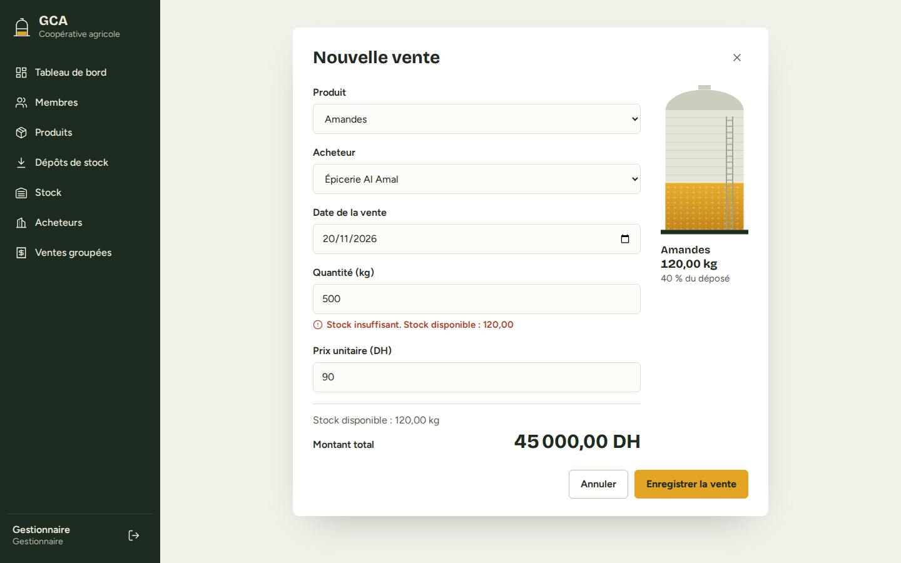
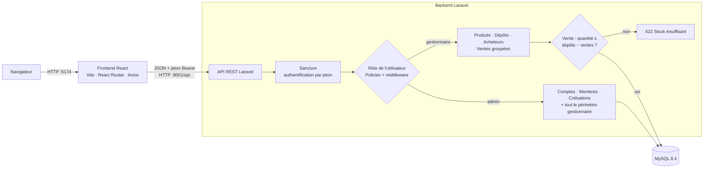
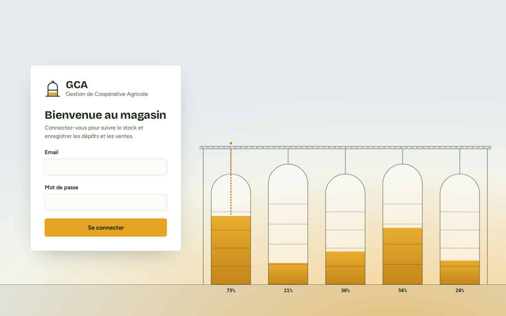
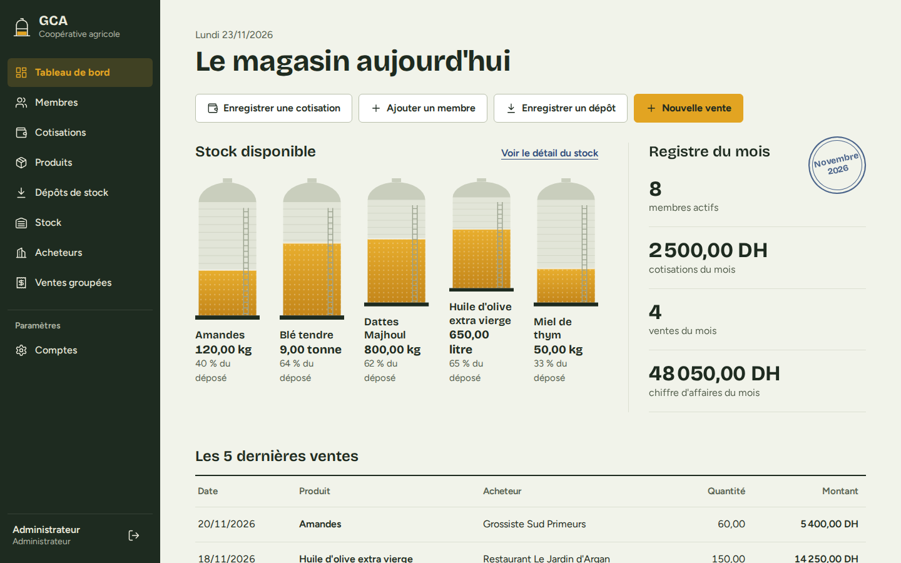
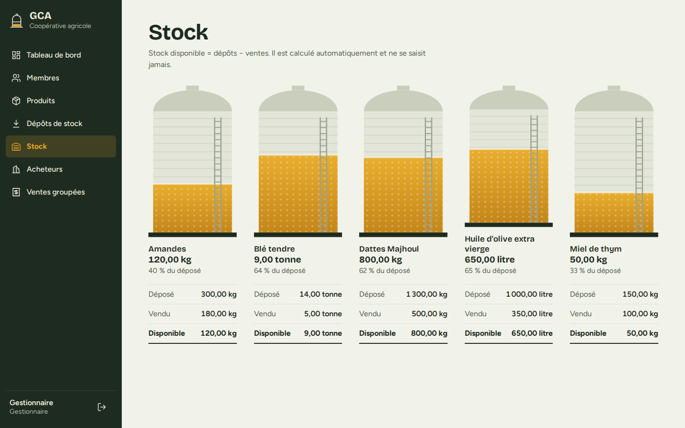
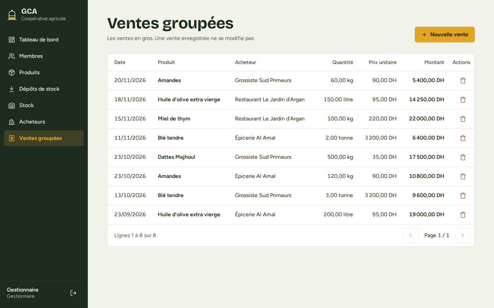

# GCA · Gestion de Coopérative Agricole

[](https://github.com/Rayantoufella/Gestion-Coop-rative-Agricole/actions/workflows/ci.yml)

> **In English.** GCA is a web app that helps an agricultural cooperative manage its members, membership fees, stock deposits and group sales.
> It is built with a Laravel REST API secured by Sanctum (two roles: administrator and manager) and a React / Vite front end.
> Its key business rule: a sale larger than the available stock is rejected by the API. It runs with a single `docker compose up`.

**Application web de gestion d'une coopérative agricole : membres, cotisations, dépôts de stock et ventes groupées, avec un contrôle du stock côté serveur.**

*Projet de module de la Licence.*



## Problème

Une coopérative agricole reçoit les récoltes de ses membres (dépôts) puis les revend en gros à des acheteurs (ventes groupées). Quand ce suivi se fait sur papier ou sur un tableur, on perd la trace du stock réel : on peut promettre à un acheteur plus que ce qui est en magasin. Les cotisations des membres sont, elles aussi, difficiles à suivre.

## Solution

GCA centralise ces informations dans une API Laravel et une interface React :

- le **stock disponible** de chaque produit est **calculé** (somme des dépôts − somme des ventes), il n'est jamais saisi à la main ;
- toute **vente supérieure au stock disponible est refusée par l'API** (réponse `422 Stock insuffisant` avec le stock restant), et le formulaire affiche le message ;
- chaque utilisateur se connecte avec un **rôle** qui limite ce qu'il peut faire, vérifié côté serveur.

## Fonctionnalités

| Domaine | Administrateur | Gestionnaire |
|---|:---:|:---:|
| Comptes gestionnaires (créer, modifier, supprimer) | ✅ | — |
| Membres : consulter | ✅ | ✅ |
| Membres : créer, modifier, supprimer | ✅ | — |
| Cotisations (date de paiement contrôlée par rapport à l'adhésion) | ✅ | — |
| Produits | ✅ | ✅ |
| Dépôts de stock | ✅ | ✅ |
| Stock disponible par produit | ✅ | ✅ |
| Acheteurs | ✅ | ✅ |
| Ventes groupées (création avec contrôle du stock, consultation, suppression) | ✅ | ✅ |
| Tableau de bord (membres actifs, cotisations et ventes du mois, stock, dernières ventes) | ✅ | ✅ |

Autres règles :

- une vente enregistrée ne se modifie pas ;
- un membre ou un produit lié à des données (cotisations, dépôts, ventes) ne peut pas être supprimé (`409`) ;
- un administrateur ne peut ni modifier ni supprimer un autre administrateur ;
- les droits sont vérifiés par des *Policies* Laravel et un middleware de rôle, pas seulement dans l'interface.

## Architecture



## Stack

| Partie | Technologies (versions du dépôt) |
|---|---|
| Backend | PHP 8.4, Laravel 13, Laravel Sanctum 4 |
| Frontend | React 19, Vite 8, React Router 7, Axios 1 |
| Base de données | MySQL 8.4 |
| Tests | PHPUnit 12 (tests de fonctionnalités et unitaires), collection Postman exécutée avec Newman |
| Qualité | oxlint (frontend) |
| Déploiement | Docker, Docker Compose, GitHub Actions |

## Démarrage rapide

Prérequis : Docker avec Docker Compose.

```bash
git clone https://github.com/Rayantoufella/Gestion-Coop-rative-Agricole.git
cd Gestion-Coop-rative-Agricole
docker compose up --build
```

Ouvrez ensuite **http://localhost:5174**.

Au premier lancement, le conteneur backend crée seul le fichier `.env`, la clé de l'application, les tables et les données de démonstration. Comptez une à deux minutes la première fois.

| Service | Adresse |
|---|---|
| Frontend React | http://localhost:5174 |
| API Laravel | http://localhost:8001/api |
| MySQL | non exposé sur la machine (accessible seulement entre conteneurs) |

### Comptes de démonstration

| Rôle | Email | Mot de passe |
|---|---|---|
| Administrateur | `admin@gca.test` | `password` |
| Gestionnaire | `gestionnaire@gca.test` | `password` |

Les données de démonstration sont **fictives** : 10 membres, 16 cotisations, 5 produits, 8 dépôts, 3 acheteurs et 8 ventes groupées. Pour voir la règle de stock, connectez-vous en gestionnaire, ouvrez *Ventes groupées → Nouvelle vente* et saisissez une quantité supérieure au stock affiché.

### Commandes utiles

```bash
docker compose up -d --build      # démarrer en arrière-plan
docker compose logs -f backend    # suivre les logs (backend, frontend ou mysql)
docker compose ps                 # état des conteneurs
docker compose down               # arrêter (les données sont conservées)
docker compose down -v            # arrêter et supprimer les données de CE projet (réinitialisation)
```

Après `docker compose down -v`, le prochain `docker compose up` recrée une base neuve avec les données de démonstration.

## Tests

Les tests utilisent une base MySQL séparée (`testing`) : ils ne touchent pas aux données de démonstration.

```bash
docker compose exec backend php artisan test
```

La collection Postman [`docs/postman/GCA.postman_collection.json`](docs/postman/GCA.postman_collection.json) vérifie la connexion, les droits des deux rôles et le refus d'une vente supérieure au stock. Elle ne modifie aucune donnée. Importez-la dans Postman ou lancez-la avec Newman pendant que l'application tourne :

```bash
npx newman run docs/postman/GCA.postman_collection.json
```

La CI GitHub Actions ([`.github/workflows/ci.yml`](.github/workflows/ci.yml)) lance à chaque pull request :

1. **Backend** : PHPUnit sur MySQL 8.4 ;
2. **Frontend** : `npm ci`, oxlint et `npm run build` ;
3. **Docker** : `docker compose config`, `build`, démarrage avec healthchecks, appel de l'API et collection Postman.

## Variables d'environnement

| Fichier | Rôle |
|---|---|
| `.env.example` (racine) | Ports sur votre machine : `GCA_FRONTEND_PORT` (5174 par défaut) et `GCA_API_PORT` (8001). Copiez-le en `.env` pour les changer. |
| `backend/.env.example` | Configuration Laravel avec des valeurs de démonstration (base `gca`, utilisateur `gca_user`). Copié automatiquement dans le conteneur. |
| `frontend/.env.example` | `VITE_API_URL`, l'adresse de l'API. Avec Docker, elle est fournie par `compose.yaml` et suit `GCA_API_PORT`. |

Aucun secret réel n'est versionné : les fichiers `.env` sont ignorés par Git.

## Structure du dépôt

```
backend/      API Laravel : contrôleurs, Form Requests, Policies, Resources, migrations, seeders, tests
frontend/     Application React : pages, composants, client Axios (src/api)
docker/       Dockerfiles PHP et Node, script de démarrage, initialisation MySQL
docs/         Captures d'écran et collection Postman
Conception/   Diagrammes (cas d'utilisation, classes, MCD, MLD)
compose.yaml  Lancement complet de l'application
```

`backend/compose.yaml` est l'ancienne configuration Laravel Sail ; elle n'est pas nécessaire pour lancer le projet.

## Captures d'écran

| | |
|---|---|
| **Connexion**<br/> | **Tableau de bord administrateur**<br/> |
| **Stock (gestionnaire)**<br/> | **Ventes groupées**<br/> |
| **Vente refusée : stock insuffisant**<br/> | |

## Auteur

Rayan Toufella · [rayantoufella.dev](https://rayantoufella.dev)
